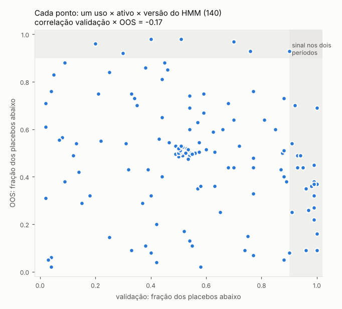
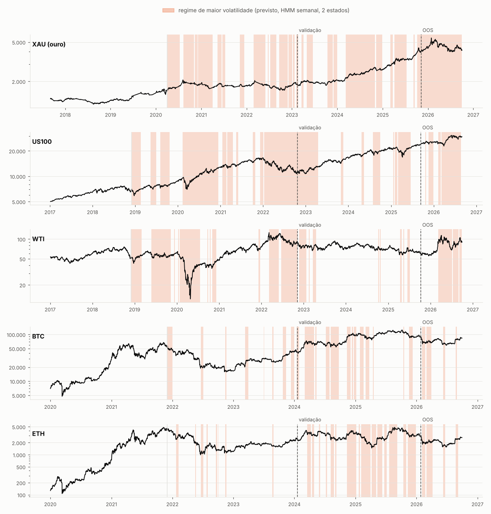

# HMM para regime de mercado: dá para ligar/desligar ou escolher estratégias pelo regime?

Scripts: `scripts/hmm_regime.py` (detector), `scripts/study_hmm.py` (testes), `scripts/hmm_walk_all.py` (resumo dos
regimes), `scripts/hmm_plot.py` (gráfico), `scripts/hmm_resumo.py` (tabelas). Saídas em `results/hmm/`.

## Resposta curta

**Não, do jeito que dá para testar com o que temos.** O HMM acerta o que ele mede: a probabilidade prevista do regime
turbulento tem correlação de +0,4 a +0,66 com a volatilidade realizada do dia seguinte (versão diária). Mas o regime
**não diz quando as estratégias aprovadas ganham dinheiro**. Nos 5 ativos, nenhum dos usos testados (filtrar o buy &
hold, ligar/desligar cada estratégia, escolher estratégias por regime, um HMM na curva da própria estratégia) ganhou do
controle sem regime **e** dos placebos na validação e no OOS ao mesmo tempo.

O resumo mais direto: de 140 combinações (uso × ativo × versão do HMM), 24 ficaram acima de 90% dos placebos na
validação; **só 1 repetiu no OOS**, que é o que o acaso entrega, e a correlação entre o percentil da validação e o do OOS
é **−0,17**. Quem foi bem na validação não foi melhor que o resto depois.



O que vale guardar:

1. **Desligar estratégia que está mal piora.** O filtro mais simples de "regime da estratégia" (só ligada se a média
   dos últimos 60 dias > 0) baixou o Sharpe em 8 de 10 casos (5 ativos × validação/OOS), e o retorno nos dias "ligados"
   foi **menor** que nos "desligados" em todos os ativos (OOS: −17 a −53 p.p. a.a.). O desempenho das aprovadas tem
   reversão em ~60 dias: drawdown recente não é sinal de que a estratégia "parou de funcionar". O HMM na curva da
   própria estratégia também não ajuda: a diferença fica perto de zero ou negativa, sem padrão entre os ativos.
2. **Única pista: escolher por regime com o HMM semanal.** Na validação ficou acima de 92% dos placebos em 6 das 10
   versões semanais (XAU, WTI, BTC e ETH), mas no OOS (8 a 11 meses) caiu para a mediana dos placebos (32% a 70%).
   Não passa no protocolo; se for acompanhar, é em papel, não com dinheiro.
3. Por tabela, o primeiro treino/validação/OOS no **ETH** (mesmo critério do `tvo.py`): a carteira K=6 teto 0,3
   escolhida no treino fez **+264% na validação (Sharpe 2,58, DD −11%) e +35% no OOS (Sharpe 1,93, DD −10%)**, contra
   −2% e −18% do B&H. Duas das seis são de giro altíssimo (Pivot Reversal 5 min, 35 mil trades; TTM scalper 15 min,
   50 mil trades) e merecem uma checagem de execução à parte antes de qualquer conclusão.

## O detector

- **Observação**: por pregão, o retorno log do dia e o log da volatilidade realizada do dia (barras de 15 min do M1).
  Dias com menos de 6 h de dados (o domingo à noite da Dukascopy) são somados ao dia seguinte. Versão **semanal**: as
  mesmas duas medidas por semana, para regimes mais lentos.
- **Modelo**: HMM gaussiano (covariância cheia) com **2 ou 3 estados**, ajustado pelo EM do `hmmlearn` com 4 chutes
  iniciais mais o ajuste do mês anterior. Os estados são ordenados pela volatilidade média: 0 = calmo, o último =
  turbulento.
- **Walk-forward, sem look-ahead**: reajuste no começo de cada mês com **todas as observações anteriores** (janela
  expansiva; mínimo de 500 dias ou 100 semanas). A probabilidade usada no dia *d* é a **previsão do filtro progressivo**
  P(estado em *d* | dados até o pregão anterior) = α·A. Nunca o suavizado (forward-backward) nem o Viterbi, que olham o
  futuro. Conferido: a última linha do filtro bate com o `predict_proba` do `hmmlearn`.
- As 4 versões (diário/semanal × 2/3 estados) foram fixadas antes de ver qualquer resultado e são todas reportadas.



Os regimes são relativos ao histórico de cada ajuste (no BTC, depois de 2023, que foi muito calmo, a volatilidade
"normal" de 2024–25 já conta como turbulenta). Persistência e qualidade da previsão de volatilidade (desde o 1º ajuste):

| Ativo | 1º ajuste | Diário, 2 estados: trocas/ano · corr. com a vol do dia | Semanal, 2 estados: trocas/ano · corr. | Sharpe do ativo no estado calmo / turbulento (diário, 2) |
| --- | --- | --- | --- | --- |
| XAU | 2020-06 | 33 · +0,58 | 8 · +0,37 | +1,70 / +0,20 |
| US100 | 2019-06 | 22 · +0,63 | 6 · +0,53 | +0,72 / +0,99 |
| WTI | 2019-01 | 18 · +0,62 | 5 · +0,50 | +0,13 / +0,25 |
| BTC | 2021-06 | 49 · +0,46 | 10 · +0,16 | −0,05 / +1,04 |
| ETH | 2021-06 | 39 · +0,42 | 11 · +0,22 | −0,04 / +0,10 |

O estado previsto separa bem a volatilidade, mas o retorno do próprio ativo por estado não tem padrão comum: no ouro o
calmo é o bom, no BTC é o turbulento, nos outros quase não há diferença. Detalhe em `results/hmm/walk_all.txt`.

## Como o regime foi usado

Universo: as estratégias **aprovadas no treino** pelo mesmo critério do `tvo.py` (10 partes; 1–6 treino, 7–9
validação, 10 OOS; geo > 0, ≥ 4/6 partes positivas, sem a melhor parte > 0, ≥ 100 trades, melhor célula por
estratégia, templates fora) e a carteira **K=6 teto 0,3** escolhida no treino.

Para cada estratégia (e para o próprio ativo) e cada data, **E** = média condicional prevista = Σₖ P(regime k previsto)
× média histórica da estratégia no regime k, e **E0** = média sem regime. As médias são reestimadas todo mês, só com
datas anteriores.

| Uso | Regra | Controle |
| --- | --- | --- |
| B&H só se E>0 | comprado quando E > 0 (com funding), senão caixa | B&H |
| B&H só no regime bom | comprado quando E > E0 | B&H |
| liga se E>0 | cada estratégia ligada só quando E > 0 | a mesma carteira sem filtro |
| liga no regime bom | cada estratégia ligada só quando E > E0 (desliga no regime em que rende abaixo da própria média) | idem |
| escolhe por regime | todo mês, para cada regime, as 6 de maior Sharpe condicional com teto de correlação 0,3; no dia, mistura as carteiras pela probabilidade prevista | a mesma escolha mensal pelo Sharpe sem regime |
| regime da própria estratégia | HMM 1-D de 2 estados no retorno diário de cada estratégia (reajuste trimestral); liga quando a média prevista > 0 ou > média | sem filtro, e o filtro simples "média dos últimos 60 dias > 0" |
| informação | retorno a.a. nos dias de regime bom (E > E0) menos nos de regime ruim, média entre as estratégias | 0 |

Custos: cada liga/desliga paga uma perna de spread da Lighter (conservador: supõe a estratégia posicionada); na
escolha, o giro dos pesos paga spread; o B&H paga funding pro-rata.

**Placebo**: o mesmo procedimento com a série de regimes **deslocada no tempo** (100 deslocamentos aleatórios). Mantém
persistência e frequência dos estados, mas perde a ligação com o mercado. Um regime que carrega informação tem de ficar
acima de ~90% dos placebos; perto de 50% é acaso.

## Resultados

Universo por ativo (aprovadas no treino): XAU 256, US100 405, WTI 143, BTC 386, ETH 408 estratégias. Validação e OOS:
XAU 2023-02 a 2025-11 / até 2026-10; US100 2022-10 a 2025-09 / até 2026-08; WTI 2022-11 a 2025-10 / até 2026-09;
BTC e ETH 2024-01 a 2026-01 / até 2026-09. As carteiras K6 reproduzem as dos estudos de treino/validação de XAU, WTI e
BTC (mesmas estratégias e mesmo resultado na validação).

Leitura das células "+0,00 · 0/4 · p50": o filtro quase nunca desligou nada. As estratégias aprovadas no treino têm média
positiva em todos os regimes, então "E > 0" fica ligado 81% a 100% do tempo. No WTI o "B&H só se E>0" ganha porque fica
de fora (o funding de 67,7% a.a. derruba o comprado), não por causa do regime: os placebos fazem o mesmo (p50).

#### Validação (partes 7–9): Sharpe do uso com HMM menos Sharpe do controle sem regime

Cada célula: diferença mediana de Sharpe nas 4 versões do HMM (diário/semanal × 2/3 estados) · em quantas das 4 o HMM ganhou do controle · percentil mediano contra os placebos (regimes deslocados no tempo; 50 = igual ao acaso, ≥ 90 = sinal).

| Uso | XAU | US100 | WTI | BTC | ETH |
|---|---|---|---|---|---|
| B&H só se E>0 | -0,29 · 1/4 · p82 | +0,00 · 0/4 · p58 | +2,42 · 4/4 · p50 | +0,00 · 0/4 · p51 | +0,00 · 0/4 · p51 |
| B&H só no regime bom | -0,25 · 0/4 · p54 | -0,26 · 1/4 · p55 | +1,66 · 4/4 · p98 | -0,25 · 1/4 · p48 | -0,29 · 1/4 · p41 |
| todas, liga se E>0 | -0,01 · 2/4 · p49 | -0,00 · 0/4 · p66 | -0,01 · 2/4 · p36 | +0,00 · 2/4 · p62 | +0,01 · 4/4 · p94 |
| todas, liga no regime bom | -0,35 · 0/4 · p22 | -0,24 · 1/4 · p34 | +0,26 · 3/4 · p70 | +0,34 · 4/4 · p90 | -0,22 · 1/4 · p52 |
| K6, liga se E>0 | -0,02 · 0/4 · p31 | +0,00 · 0/4 · p54 | +0,00 · 1/4 · p48 | +0,00 · 0/4 · p50 | +0,00 · 0/4 · p51 |
| K6, liga no regime bom | +0,05 · 2/4 · p84 | -0,23 · 1/4 · p57 | -0,30 · 2/4 · p33 | +0,09 · 2/4 · p84 | -1,88 · 0/4 · p4 |
| escolhe por regime | +0,59 · 3/4 · p68 | -0,17 · 0/4 · p43 | -0,16 · 1/4 · p53 | +0,20 · 4/4 · p78 | -0,12 · 1/4 · p92 |

#### Validação (partes 7–9): informação do regime (retorno a.a. nos dias de regime bom menos nos de regime ruim)

| Medida | XAU | US100 | WTI | BTC | ETH |
|---|---|---|---|---|---|
| informação, ativo | -0,01 · p48 | +0,04 · p54 | +0,05 · p54 | +0,51 · p71 | -0,25 · p46 |
| informação, estratégias | -0,00 · p50 | +0,04 · p83 | -0,08 · p10 | +0,24 · p90 | -0,09 · p50 |

#### OOS (parte 10): Sharpe do uso com HMM menos Sharpe do controle sem regime

Cada célula: diferença mediana de Sharpe nas 4 versões do HMM (diário/semanal × 2/3 estados) · em quantas das 4 o HMM ganhou do controle · percentil mediano contra os placebos (regimes deslocados no tempo; 50 = igual ao acaso, ≥ 90 = sinal).

| Uso | XAU | US100 | WTI | BTC | ETH |
|---|---|---|---|---|---|
| B&H só se E>0 | -0,23 · 1/4 · p47 | +0,00 · 0/4 · p50 | +0,15 · 4/4 · p50 | +0,00 · 0/4 · p50 | +0,00 · 0/4 · p50 |
| B&H só no regime bom | -0,24 · 1/4 · p36 | +0,02 · 2/4 · p65 | -0,37 · 1/4 · p32 | -0,31 · 0/4 · p26 | -0,80 · 0/4 · p18 |
| todas, liga se E>0 | +0,01 · 3/4 · p67 | -0,00 · 1/4 · p36 | -0,39 · 0/4 · p22 | -0,01 · 1/4 · p39 | -0,01 · 1/4 · p36 |
| todas, liga no regime bom | -0,18 · 0/4 · p44 | +0,09 · 3/4 · p66 | -0,70 · 0/4 · p25 | -0,16 · 1/4 · p54 | +0,04 · 2/4 · p53 |
| K6, liga se E>0 | +0,00 · 0/4 · p53 | +0,00 · 0/4 · p53 | -0,09 · 0/4 · p34 | +0,00 · 0/4 · p50 | +0,00 · 0/4 · p50 |
| K6, liga no regime bom | -0,19 · 0/4 · p40 | +0,69 · 3/4 · p90 | +0,13 · 3/4 · p79 | +0,51 · 3/4 · p84 | -1,75 · 0/4 · p6 |
| escolhe por regime | +0,07 · 3/4 · p66 | +0,67 · 3/4 · p64 | +0,04 · 2/4 · p38 | +0,13 · 3/4 · p26 | +0,18 · 4/4 · p50 |

#### OOS (parte 10): informação do regime (retorno a.a. nos dias de regime bom menos nos de regime ruim)

| Medida | XAU | US100 | WTI | BTC | ETH |
|---|---|---|---|---|---|
| informação, ativo | -0,34 · p28 | +0,26 · p75 | -0,86 · p32 | -0,70 · p25 | -3,46 · p4 |
| informação, estratégias | -0,54 · p4 | +0,05 · p74 | -0,24 · p37 | -0,08 · p44 | +0,04 · p52 |

#### Controles sem regime (Sharpe)

| Carteira | Período | XAU | US100 | WTI | BTC | ETH |
|---|---|---|---|---|---|---|
| bh | valid | +0,99 | +1,11 | -2,42 | +0,81 | +0,33 |
| bh | oos | -0,18 | +0,91 | -0,15 | -0,20 | -0,14 |
| todas | valid | +0,65 | +1,13 | -0,56 | +0,59 | +0,68 |
| todas | oos | +0,79 | +0,16 | +0,69 | +0,91 | +0,44 |
| k6 | valid | +1,10 | +0,81 | -0,24 | +1,33 | +2,58 |
| k6 | oos | +0,04 | -0,21 | +0,66 | +0,54 | +1,93 |
| escolhe_sem_regime | valid | -0,32 | +0,64 | +0,67 | +1,40 | +2,77 |
| escolhe_sem_regime | oos | +1,11 | -0,38 | -0,03 | +0,61 | +1,31 |


#### Regime da própria estratégia

Sharpe da carteira com todas as aprovadas, sem filtro / com o HMM 1-D da própria estratégia (liga se a média prevista
> 0) / liga só no estado bom / filtro de média de 60 dias:

| Ativo | Validação | OOS |
| --- | --- | --- |
| XAU | 0,65 / 0,57 / 0,00 / 0,53 | 0,79 / 0,80 / 0,26 / 0,19 |
| US100 | 1,13 / 1,13 / 0,87 / 0,73 | 0,16 / 0,09 / 0,13 / −0,26 |
| WTI | −0,56 / −0,53 / −0,38 / −0,41 | 0,69 / 0,43 / 0,28 / 0,00 |
| BTC | 0,59 / 0,57 / 0,35 / 0,30 | 0,91 / 0,87 / 0,71 / 0,32 |
| ETH | 0,68 / 0,59 / 0,16 / 0,72 | 0,44 / 0,35 / −0,27 / 0,00 |

Tabelas completas (com a K6) em `results/hmm/resumo.md`; todas as linhas em `results/hmm/resumo.csv`.

## Por que não funciona

- **O que o HMM separa é volatilidade**, e volatilidade não decide o sinal do retorno destas estratégias. Quase todas
  são stop-and-reverse rápidas, sempre posicionadas, que ganham com movimento de 1 a 3 dias (nota
  `padrao_vencedoras.md` da pasta do projeto). Em vol alta elas ganham e perdem mais, mas o saldo não muda de lado de
  forma estável.
- **A relação regime → desempenho muda com o tempo.** A média condicional estimada com o passado aponta um regime "bom"
  que, no período seguinte, deixa de ser. É o mesmo problema que a seleção por treino já tinha (a ilha que morre no OOS),
  agora com uma dimensão a mais para sobreajustar.
- **Mais condicionamento = menos dados por célula.** Escolher as 6 melhores de 150–400 estratégias dentro de cada regime
  usa uma fração da história e amplia o viés de seleção. No OOS a escolha por regime ganhou do controle em 15 das 20
  versões (mediana +0,16 de Sharpe), mas os regimes aleatórios ganharam em 17 de 20 (mediana +0,24): o ganho vem de
  misturar carteiras escolhidas em pedaços diferentes da história, não do HMM.
- **Desligar no drawdown corta a recuperação.** O desempenho das aprovadas reverte em ~60 dias; um filtro de
  "está indo mal, desliga" fica de fora justamente do trecho em que ela se recupera.

## O que tentar depois

- Se o objetivo é atravessar períodos ruins, o caminho com mais chance é **diversificar entre ativos**, não ligar e
  desligar dentro de um ativo: carteiras de 4–5 ativos com as aprovadas de cada um diluem o período ruim de cada
  estratégia sem precisar prever quando ele vem.
- O HMM é útil como **medida de risco** (prevê volatilidade): dimensionar a posição pela vol prevista é outra pergunta,
  não testada aqui.
- Continuar medindo a "escolha por regime com HMM semanal" conforme o OOS cresce; reprovar de vez se seguir na mediana
  dos placebos.
- Regras simples de alta/baixa no lugar do HMM (média de 200, cruzamento, momento de 12 meses, queda de 20%): testadas
  em [REGIME_SIMPLES.md](REGIME_SIMPLES.md), mesmo resultado.

## Como reproduzir

As séries diárias de ETH, WTI e US100 (`results/<ativo>_4p_8p_full/*_ser.parquet`, ~1 GB) não foram commitadas; os
`lote*.csv` sim. O custo do ETH passou para o medido na Lighter (0,35 bp por perna, funding 11,2% a.a.), o mesmo do
estudo de padrão das aprovadas. O `study_us100_4p.py` com `FULL=1` agora pula o lote cuja série já existe, então o
`run_full.sh` retoma de onde parou.

```bash
pip install -r requirements.txt               # inclui hmmlearn
ATIVO=eth J=3 bash scripts/run_full.sh        # séries diárias de todas as células (retoma de onde parou)
EXCL=2020-04-01,2020-05-01 ATIVO=wti J=3 bash scripts/run_full.sh   # WTI sem os trades de abril de 2020
cd scripts
python hmm_walk_all.py                        # HMM walk-forward dos 5 ativos e resumo dos regimes
NPLAC=100 python study_hmm.py xau us100 wti btc eth
python hmm_resumo.py && python hmm_plot.py W 2
```
