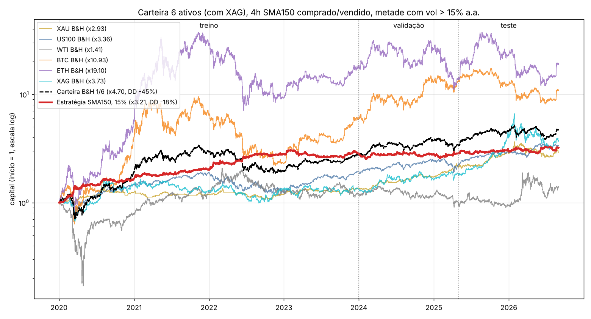

# Carteira de 6 ativos (5 + XAG): média longa + metade com vol da carteira alta, só 4h

Scripts: `scripts/study_ma_vol_cart6.py`, `scripts/plot_ma_vol_cart6.py`; dados da prata com `data/xag_1m_dl.py` (Dukascopy 1m).
Mesmo método da carteira de 5 (`docs/MA_VOL_CARTEIRA.md`), peso 1/6, só 4h, 126 células. XAG: spread 0,65 bp, funding 16,2% a.a. (XAU 13,8% + 2,4% de diferença medida na Lighter).

| Célula escolhida pelo treino | Treino Sharpe / CAGR / DD | Validação | Teste | B&H 1/6 treino / valid / teste |
|---|---|---|---|---|
| 4h SMA150, metade acima de 15% a.a. | 1,28 / +29,5% / −16,5% | 0,04 / +0,7% / −15% | 0,46 / +9,9% / −14% | 0,24 / 0,03 / 0,25 |

- Reprovada pelo critério (validação 0,04). Curva 2020–2026: x3,21 com DD −18%, contra x4,70 e DD −45% da carteira B&H.
- A grade como um todo melhorou no teste: 94% das células positivas na validação, 100% no teste; mediana validação/teste 0,38/0,67 sem filtro, 0,57/0,92 com 15% a.a., 0,58/0,96 com percentil 70.
- O treino escolheu de novo SMA150, que nesta carteira foi a pior vizinhança fora do treino; EMA150/200 com 15–20% tiveram validação 0,6–0,9 e teste 0,7–0,9.

