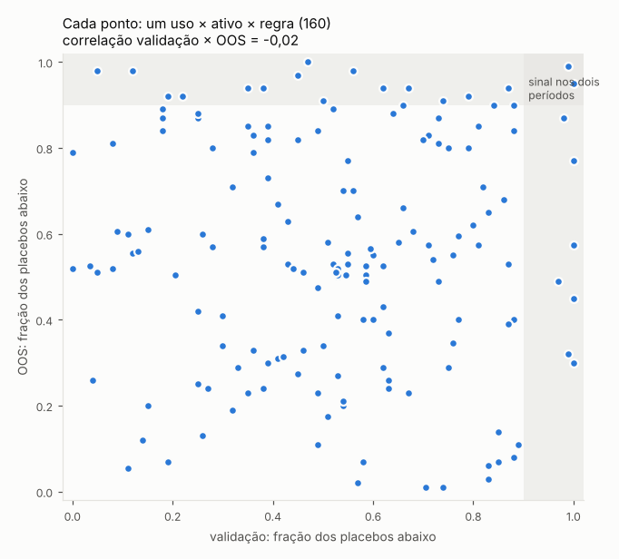

# Regras simples de alta/baixa: dá para trocar de estratégia pelo regime?

Script: `scripts/study_regime_simples.py` (usa o mesmo motor de `scripts/study_hmm.py`). Saídas em
`results/regime_simples/`. Continuação de [HMM_REGIME.md](HMM_REGIME.md): mesmas estratégias aprovadas, mesmos usos,
mesmos controles e placebos, trocando o HMM por regras de tendência que qualquer um calcula no gráfico.

## Resposta curta

**Também não.** Nenhuma das 4 regras deu uma forma consistente de escolher ou ligar/desligar estratégias. O que foi bem
na validação (partes 7–9) não repetiu no OOS (parte 10), e o que foi bem no OOS tinha ido mal na validação:

- **Escolher as estratégias pelo regime** (o uso que interessa): no XAU ganhou do controle nas 4 regras na validação
  (Sharpe +0,87 na mediana) e perdeu no OOS (−0,90). No US100, WTI e BTC foi o contrário: nada na validação, bom no OOS.
- **Buy & hold só em alta** (o filtro de tendência clássico): no BTC e no ETH ficou à frente do B&H no OOS nas 4 regras
  (Sharpe +0,57 e +0,94), mas atrás na validação (−0,27 e −0,35). O OOS das criptos foi uma queda contínua; ficar de
  fora dela é um episódio só, não uma regra que se provou.
- De 160 combinações (uso × ativo × regra), **9** ficaram acima de 90% dos placebos na validação e **2** repetiram no
  OOS, menos do que o acaso daria (16 e 1,6). A correlação entre o percentil da validação e o do OOS é **−0,02**.



Junto com o HMM, a conclusão é a mesma: com o histórico que temos (validação de 2 a 3 anos, OOS de 8 a 11 meses), o
regime de mercado, por qualquer das definições testadas, não diz com antecedência quais das aprovadas vão ganhar.

## As regras

Todas usam só o fechamento diário do ativo. O regime é decidido no fechamento do pregão e vale a partir do pregão
seguinte, igual ao HMM.

| Regra | Alta quando | Trocas de regime por ano | Dias em alta |
|---|---|---|---|
| `mm200` | fechamento > média dos últimos 200 pregões | 4,8 a 11,6 | 51% a 81% |
| `cruz` | média de 50 pregões > média de 200 | 0,7 a 1,9 | 53% a 82% |
| `mom12` | fechamento > fechamento de 365 dias antes | 1,2 a 5,6 | 48% a 86% |
| `dd20` | fechamento ≥ 80% da máxima dos últimos 365 dias | 2,4 a 11,6 | 35% a 95% |

As faixas são entre os 5 ativos. No XAU e no US100 o regime fica em alta 73% a 95% do tempo, então quase não há
história de baixa para estimar nada; no WTI e nas criptos fica perto de meio a meio.

## Como foi testado

Igual ao estudo do HMM, para comparar as duas coisas com a mesma régua:

- Estratégias: as aprovadas no treino (partes 1–6) pelo critério do `tvo.py`, uma célula por estratégia, sem templates.
- Todo mês, médias e Sharpes condicionais a cada regime são reestimados **só com o passado** (mínimo de 250 pregões).
- Usos: `bh_regra` (comprado só em alta); `bh_reg` e `bh_rel` (B&H ligado se a média condicional > 0, ou só no regime
  que foi melhor); `todas_reg`/`todas_rel` e `k6_reg`/`k6_rel` (o mesmo para cada estratégia aprovada e para a carteira
  K=6 teto 0,3); `escolhe_reg` (todo mês as 6 melhores pelo Sharpe no histórico de alta e as 6 melhores no de baixa,
  com teto de correlação 0,3; no dia, a carteira do regime vigente).
- Controles sem regime: B&H, todas as aprovadas, K=6 e `escolhe_sem_regime` (as 6 melhores pelo Sharpe total).
- Placebos: a série de regimes deslocada no tempo (100 deslocamentos aleatórios). Mantém quanto tempo se fica em cada
  regime e quantas trocas há, mas tira a ligação com o mercado. Percentil ≥ 90 = sinal.
- Custo de troca e funding iguais ao estudo do HMM.

## Resultados

Cada célula: diferença de Sharpe (uso − controle sem regime), mediana nas 4 regras · em quantas das 4 a regra ganhou do
controle · percentil mediano contra os placebos.

#### Validação (partes 7–9)

| Uso | XAU | US100 | WTI | BTC | ETH |
|---|---|---|---|---|---|
| B&H só em alta | −0,10 · 0/4 · p63 | −0,23 · 0/4 · p12 | +0,64 · 3/4 · p50 | −0,27 · 1/4 · p48 | −0,35 · 1/4 · p24 |
| B&H só no regime bom | −0,39 · 0/4 · p52 | −0,43 · 0/4 · p38 | +0,61 · 4/4 · p37 | −0,27 · 1/4 · p54 | −0,35 · 1/4 · p29 |
| todas, liga se E>0 | −0,07 · 1/4 · p16 | −0,01 · 1/4 · p48 | +0,09 · 4/4 · p62 | −0,01 · 1/4 · p52 | −0,00 · 2/4 · p49 |
| todas, liga no regime bom | −0,22 · 1/4 · p33 | −0,09 · 0/4 · p54 | +0,19 · 4/4 · p66 | −0,03 · 2/4 · p68 | −0,22 · 1/4 · p44 |
| K6, liga no regime bom | −0,12 · 1/4 · p63 | −0,03 · 1/4 · p78 | −0,16 · 1/4 · p32 | −0,42 · 1/4 · p40 | −0,58 · 0/4 · p65 |
| **escolhe por regime** | **+0,87 · 4/4 · p78** | +0,07 · 2/4 · p80 | −0,40 · 0/4 · p39 | −0,97 · 0/4 · p36 | −0,68 · 0/4 · p57 |

#### OOS (parte 10)

| Uso | XAU | US100 | WTI | BTC | ETH |
|---|---|---|---|---|---|
| B&H só em alta | +0,02 · 2/4 · p60 | +0,00 · 0/4 · p56 | −0,08 · 2/4 · p40 | +0,57 · 4/4 · p87 | +0,94 · 4/4 · p86 |
| B&H só no regime bom | +0,02 · 2/4 · p52 | −0,91 · 0/4 · p30 | +0,29 · 3/4 · p66 | +0,57 · 4/4 · p73 | +0,94 · 3/4 · p78 |
| todas, liga se E>0 | +0,01 · 3/4 · p84 | +0,00 · 2/4 · p43 | −0,30 · 1/4 · p44 | −0,04 · 0/4 · p40 | +0,02 · 2/4 · p74 |
| todas, liga no regime bom | −0,07 · 1/4 · p60 | −0,13 · 1/4 · p47 | −0,48 · 1/4 · p36 | +0,22 · 3/4 · p86 | −0,01 · 2/4 · p54 |
| K6, liga no regime bom | +0,03 · 2/4 · p54 | +0,45 · 3/4 · p82 | −0,09 · 2/4 · p52 | −0,45 · 1/4 · p26 | −1,29 · 0/4 · p24 |
| **escolhe por regime** | **−0,90 · 1/4 · p30** | +1,15 · 4/4 · p82 | +0,54 · 3/4 · p66 | +0,21 · 3/4 · p73 | −0,12 · 2/4 · p69 |

#### Escolher por regime, regra a regra (Sharpe do uso − controle · percentil contra placebos)

| Regra | Período | XAU | US100 | WTI | BTC | ETH |
|---|---|---|---|---|---|---|
| mm200 | valid | +0,83 · p74 | −0,02 · p73 | −0,36 · p45 | −0,57 · p56 | −0,54 · p73 |
| mm200 | oos | −2,28 · p1 | +1,18 · p87 | +0,82 · p82 | +2,02 · p98 | +0,35 · p81 |
| cruz | valid | +0,79 · p65 | +0,15 · p85 | −0,85 · p5 | −1,18 · p15 | −0,74 · p60 |
| cruz | oos | −0,22 · p58 | +0,02 · p14 | +0,25 · p51 | −0,29 · p20 | −0,39 · p40 |
| mom12 | valid | +1,01 · p88 | −0,07 · p74 | −0,23 · p39 | −0,75 · p66 | −0,62 · p55 |
| mom12 | oos | +0,34 · p84 | +1,28 · p91 | +0,94 · p85 | +0,06 · p66 | +0,01 · p77 |
| dd20 | valid | +0,90 · p83 | +0,60 · p100 | −0,44 · p39 | −2,39 · p0 | −1,26 · p15 |
| dd20 | oos | −1,59 · p3 | +1,12 · p77 | −0,01 · p30 | +0,36 · p79 | −0,25 · p61 |

O `mom12` é a regra menos ruim: no XAU ficou à frente nos dois períodos (+1,01 e +0,34, p88 e p84) e no OOS ganhou em
todos os ativos. Mas na validação perdeu do controle no US100, WTI, BTC e ETH, e nenhuma célula passou de p90 nos dois
períodos. Escolher a regra olhando esta tabela seria ajustar ao OOS.

#### As duas combinações acima de p90 nos dois períodos

- **ETH, B&H ligado quando a média do regime atual (mm200) é > 0**, na prática só em alta: Sharpe 0,43 contra 0,33 do B&H na validação (drawdown −39%
  contra −68%) e 1,30 contra −0,14 no OOS (exposição de 17%). É o filtro de tendência clássico, e ajuda pelo drawdown.
  Mas a mesma regra no BTC tem Sharpe menor que o B&H na validação (0,57 contra 0,81), e no ETH as outras 3 regras
  também perdem na validação.
- **WTI, carteira K=6 ligada pelo cruzamento 50 × 200**: Sharpe 0,11 contra −0,24 na validação e 0,83 contra 0,66 no
  OOS (ligada só no regime bom: 0,21 e 1,34, p87 e p94). O cruzamento troca ~2 vezes por ano, então a validação tem
  meia dúzia de episódios.

Duas em 160 é o que o acaso entrega; não há por que acreditar mais nessas do que nas outras 158.

## Por que não funciona

1. **Pouca história de regime.** Com o cruzamento (0,7 a 1,9 trocas por ano) a validação tem poucos episódios de
   baixa; com a média de 200 (4,8 a 11,6 trocas por ano) boa parte das trocas é ruído em volta da média. No XAU e no US100
   a baixa é 5% a 27% do tempo, então "as melhores em baixa" são escolhidas com poucas dezenas de pregões.
2. **As aprovadas já são escolhidas por funcionar no treino inteiro, em alta e em baixa.** O que sobra para o regime
   explicar é pequeno; o estudo do HMM mostrou que a diferença entre regimes não persiste de um período para o outro, e
   aqui foi igual.
3. **No OOS (8 a 11 meses) quase não há troca de regime.** BTC e ETH ficaram em baixa em 76% a 100% dos dias, conforme
   a regra; o US100 ficou em alta em 96% a 100%. Qualquer regra que acertou esse único episódio parece ótima no OOS, e
   a validação mostra que não era regra.

## O que ainda dá para tentar

Se quiser insistir em alta/baixa, o próximo passo que muda a pergunta (e não só a régua) é **separar compra e venda**:
regerar as estratégias com saída só comprada e só vendida e, em alta, ligar só as compras; em baixa, só as vendas.
Hoje cada estratégia mistura as duas pontas, e o regime pode estar ajudando uma e atrapalhando a outra ao mesmo tempo.
Custa regerar as grades nos 5 ativos (algumas horas) e cai no mesmo teste de validação × OOS.

## Como reproduzir

```bash
cd scripts
python study_regime_simples.py            # 5 ativos x 4 regras, 100 placebos; ~1 h
python study_regime_simples.py xau btc    # só alguns ativos
python study_regime_simples.py resumo     # só as tabelas e o gráfico, a partir dos CSVs
```

Usa o cache de aprovadas do estudo do HMM (`results/hmm/cache/apr_<ativo>.*`); se não existir, é recriado a partir das
grades `results/<ativo>_4p_8p_full/` (lotes e séries `_ser.parquet`).
