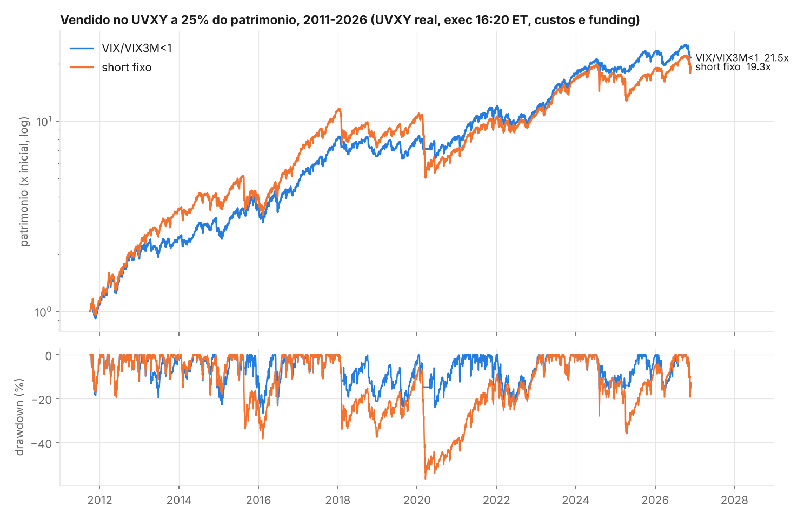
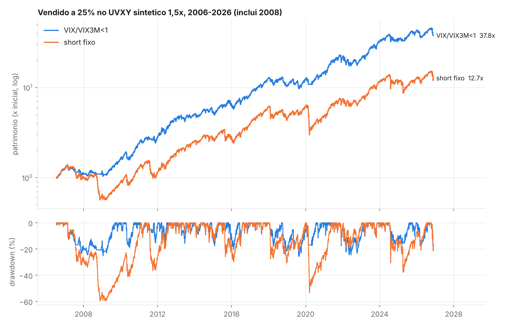
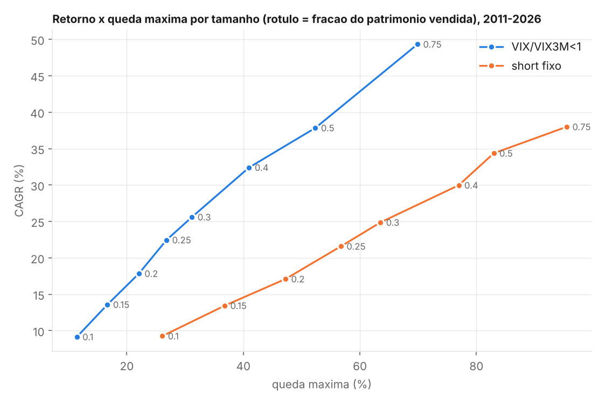

# UVXY: short estrutural com proteção contra picos

**Veredito: candidata a paper trading, não aprovada pelo critério estrito do projeto.**
Ficar vendido no UVXY só quando a estrutura a termo do VIX está em contango
(VIX/VIX3M < 1 no fechamento) mantém o retorno do short fixo e corta a queda máxima pela
metade, em todos os recortes: 2011–2018, 2019–2026 e no UVXY sintético de 2006–2026 que
inclui 2008. Com 25% do patrimônio vendido: **+22,5% a.a., queda máxima −27%, Sharpe 0,93**
(2011–2026), contra +21,6% a.a. e −57% do short fixo.

Três ressalvas pesam na decisão:

1. **O lucro vem do decaimento, não do sinal.** Qualquer short ganha. O filtro agrega na
   queda máxima (t = 5,3 contra períodos fora sorteados), mas pouco no retorno (t = 1,1).
   Por isso falha no item "t > 2 contra o controle".
2. **É em boa parte beta de bolsa.** Com 25% vendido, o beta semanal contra o S&P é ~1 e a
   correlação é 0,6. O alfa sobre o S&P é de 10%/ano com t = 2,1 no período todo, e cai
   para 6,6%/ano com t = 1,1 em 2019–2026. O Sharpe (0,93) é parecido com o de comprar o
   S&P (0,82).
3. **Picos em contango não têm defesa.** O sinal é diário. Nos 45 dias em que o UVXY
   subiu mais de 20% estando vendido, a estratégia perdeu, somando os logs, mais do que
   ganhou no período inteiro. Junho/2020 (−20% num dia, com 0,3x) e novembro/2026 são
   desse tipo. O que os limita é o tamanho pequeno, não o filtro.

A regra dos 5 ativos (XAU, US100, WTI, BTC, ETH) não se aplica: nenhum deles tem
decaimento estrutural de produto alavancado. O teste foi feito no UVXY e em outros ETFs
alavancados da AlphaX (§8).

## A regra

| Item | Valor |
| --- | --- |
| Instrumento | perp UVXY-SWAP-USDT da AlphaX (opera 24/7, acompanha o UVXY no pré e pós-mercado) |
| Sinal | VIX/VIX3M no fechamento do dia (16:15 ET). `< 1` vendido, `≥ 1` zerado |
| Execução | logo depois do sinal, ~16:20 ET, no perp (no backtest: preço do UVXY às 16:20 no M1 da Alpaca) |
| Tamanho | vendido em 25% do patrimônio |
| Rebalanceio | só quando a exposição sai de [20%, 31%] (banda de 25%) |
| Stop | nenhum (stops pioram a queda máxima, §5) |
| Custos | 10 bp por perna (spread medido de 13 bp, 3 ticks, + slippage) |
| Funding | modelado da AlphaX: vendido recebe +5,5 bp/pregão em contango e paga −33 bp/pregão em backwardation (§6) |

Giro de ~4,5× o patrimônio por ano e ~6 entradas (e saídas) por ano. Com 25% de exposição e
margem cruzada, a liquidação exigiria o UVXY subir ~390% sem a regra sair.

## Dados

| Série | Fonte | Período | Uso |
| --- | --- | --- | --- |
| UVXY diário (split-ajustado) | Yahoo | 2011-10 → 2026-11 | série principal. Até fev/2018 o UVXY era 2x, depois 1,5x |
| UVXY M1 (com pré/pós) | Alpaca (PR #26) | 2016 → 2026-11 | preço às 16:20 ET para a execução |
| UVXY sintético 1,5x | Cboe `^SHORTVOL` (Yahoo) | 2005-12 → 2026-11 | −1 × retorno do índice de futuros curtos de VIX × 1,5 − 0,95%/ano. Bate com o UVXY real depois de 2018 (corr. diária 0,987, CAGR −66,4% vs −66,9%) |
| VIX, VIX3M, VIX9D, VVIX, S&P 500 | Yahoo | 2006 → 2026 | sinais |
| Perp UVXY 1h + funding | API pública da AlphaX | 2026-06 → 2026-11 | custo, funding e checagem no perp real (§7) |

`scripts/uvxy_short/fetch_daily.py` baixa as séries diárias; os candles/funding da AlphaX
vêm de `corretoras/alphax_api/dl.py` (pasta do projeto). O sintético não tem máxima nem
abertura, então roda com execução no fechamento e sem stop.

## 1. Short fixo, sem proteção (baseline)

`results/uvxy_short/s01_baseline.txt`. Rebalanceio diário no fechamento, 10 bp/perna:

| Tamanho | CAGR | Queda máxima | Pior dia |
| --- | ---: | ---: | ---: |
| 0,5x | +29% | −85% | −33% |
| 1x | +10% | −99% | −66% |
| 1x com execução na abertura seguinte | liquida em fev/2018 | | |

O short fixo ganha nos 15 anos, mas com quedas que inviabilizam qualquer tamanho útil.

## 2. Proteções testadas

Cada variante foi escalada para a mesma volatilidade da regra base e comparada no IS
(2011–2018), no OOS (2019–2026) e no sintético 2006–2026 (`s05_camadas.csv`):

| Variante | Sharpe | Queda máx. | Sharpe OOS | Sharpe sintético |
| --- | ---: | ---: | ---: | ---: |
| **VIX/VIX3M < 1 (base)** | **0,90** | **−31%** | **0,71** | **0,99** |
| + VRP 5d > 0 (VIX acima da vol realizada do S&P) | 1,01 | −36% | 0,73 | 1,09 |
| + VRP 10d / 20d > 0 | 0,79–0,81 | −31 a −35% | 0,61–0,63 | 0,93–0,94 |
| + VIX abaixo da média de 10/20 dias | 0,66–0,81 | −37 a −45% | 0,26–0,61 | 0,75–0,81 |
| + UVXY abaixo da média de 10 dias | 0,62 | −45% | 0,20 | 0,68 |
| + VIX < 25 | 0,71 | −33% | 0,37 | 0,73 |
| + VIX9D/VIX < 1 | 0,74 | −40% | 0,44 | — |
| + VVIX < 100…130 (w=0,3) | 0,68–0,81 | −34 a −49% | 0,26–0,50 | 0,67–0,87 |
| + stop intradiário de 15% / 25% | 0,94 / 0,88 | −41% | 0,78 / 0,64 | — |
| + alvo de vol (20d / 60d) | 0,63 / 0,69 | −41 / −47% | 0,50 / 0,56 | 0,87 / 0,80 |
| + tamanho linear na curva (cheio em 0,8, zero em 1) | 0,78 | −37% | 0,31 | 0,83 |
| short fixo | 0,81 | −58% | 0,58 | 0,63 |
| + hedge vendido no S&P, sem funding (§9) | 0,68–0,87 | −27 a −36% | 0,25–0,61 | — |

Nenhuma camada melhora a base de forma consistente. O VRP de 5 dias sobe o Sharpe um
pouco, mas piora a queda máxima, e o de 10/20 dias piora tudo. Numa grade maior
(`s03_grade.csv`, 18 sinais × 5 tamanhos × 4 stops × 2 execuções, alavancagem ajustada
para queda de 30% no IS), **a correlação de ranking entre IS e OOS foi 0,02–0,10**: escolher
pelo IS não escolhe nada. Os campeões do IS (VRP 5d com tamanho linear) fizeram +2% a.a. no
OOS. Por isso fica a regra sem parâmetro ajustado, com o limiar natural de 1.

## 3. Resultado da regra (25% do patrimônio)

`results/uvxy_short/s09_final.txt`

| Série | Regra | CAGR | Queda máx. | Sharpe | Pior dia | Exposto |
| --- | --- | ---: | ---: | ---: | ---: | ---: |
| UVXY 2011–2026 | VIX/VIX3M<1 | +22,5% | −26,8% | 0,93 | −16,7% | 93% |
| IS 2011–2018 | VIX/VIX3M<1 | +29,6% | −26,8% | 1,08 | −12,7% | 93% |
| OOS 2019–2026 | VIX/VIX3M<1 | +16,3% | −24,2% | 0,77 | −16,7% | 93% |
| Sintético 1,5x 2006–2026 | VIX/VIX3M<1 | +19,5% | −25,9% | 0,97 | −11,1% | 89% |
| Sintético 2006–2011 (antes do UVXY, com 2008) | VIX/VIX3M<1 | +20,2% | −25,2% | 1,20 | −8,7% | 77% |
| UVXY 2011–2026 | short fixo | +21,6% | −56,7% | 0,81 | −18,9% | 100% |
| OOS 2019–2026 | short fixo | +13,0% | −54,1% | 0,58 | −15,5% | 100% |
| Sintético 2006–2026 | short fixo | +13,3% | −59,6% | 0,63 | −15,9% | 100% |
| Sintético 2006–2011 | short fixo | −0,3% | −59,6% | 0,10 | −8,7% | 100% |

Terços do período real: +34% / +21% / +13% a.a. (Sharpe 1,14 / 0,94 / 0,67). Positivo nos
três, mas em queda: os últimos anos são os mais fracos.

Retorno por ano (2006–2010 do sintético):

| Ano | VIX/VIX3M<1 | short fixo | UVXY |
| ---: | ---: | ---: | ---: |
| 2007 | −10,3% | −19,6% | |
| 2008 | +3,5% | −36,9% | |
| 2009 | +36,8% | +36,1% | |
| 2010 | +49,8% | +45,2% | |
| 2012 | +74,7% | +87,7% | −97,1% |
| 2013 | +28,7% | +63,9% | −92,0% |
| 2014 | +7,0% | +8,7% | −62,5% |
| 2015 | +36,1% | +7,3% | −77,5% |
| 2016 | +28,5% | +54,4% | −93,8% |
| 2017 | +75,9% | +81,3% | −94,2% |
| 2018 | −18,2% | −34,3% | +60,1% |
| 2019 | +22,4% | +42,3% | −84,2% |
| 2020 | +2,9% | −32,1% | −17,4% |
| 2021 | +43,5% | +46,7% | −88,3% |
| 2022 | −4,5% | +3,2% | −44,8% |
| 2023 | +58,0% | +55,8% | −87,7% |
| 2024 | +4,7% | +1,6% | −50,9% |
| 2025 | +23,7% | +10,5% | −65,3% |
| 2026 | −6,7% | +2,6% | −36,2% |

Nos anos calmos o filtro rende menos que o short fixo, porque sai em backwardations curtas
que logo voltam. O ganho aparece em 2008, 2015, 2018, 2020 e 2025.

## 4. Tamanho

Bootstrap em blocos de 60 pregões, janelas de 5 anos (`s08_bootstrap.txt`):

| Tamanho | CAGR mediano | Queda máx. mediana | Queda máx. pior 10% | P(queda > 40%) |
| ---: | ---: | ---: | ---: | ---: |
| 15% | 12–14% | −15 a −17% | −22 a −25% | ~0% |
| 20% | 17–19% | −19 a −23% | −28 a −32% | 0–2% |
| **25%** | **21–24%** | **−24 a −28%** | **−35 a −39%** | **4–8%** |
| 30% | 25–28% | −28 a −34% | −40 a −46% | 10–24% |
| 40% | 31–35% | −37 a −43% | −51 a −58% | 37–60% |

(faixa = sintético 2006–2026 / UVXY real 2011–2026). O bootstrap só reembaralha picos que
já aconteceram. Um Volmageddon a 1,5x em contango (+144% num pregão) custaria ~36% com 25%
vendido, sem liquidar.

## 5. Robustez (com 30% do patrimônio, `s04_robustez.txt`)

**Limiar do VIX/VIX3M.** O Sharpe fica entre 0,68 e 0,98 de 0,95 a 1,10. A queda máxima
pula entre −31% e −50% conforme um ou outro evento cai de um lado do limiar. Ago/2024 é o
caso: em 02/08 o índice fechou em 1,002, e a regra saiu antes do gap de +67% da segunda.
O limiar 1,0 também é o melhor no sintético, mas a queda de −31% com 30% tem uma dose
de sorte; −40% é uma expectativa mais honesta para esse tamanho.

| Limiar | CAGR | Queda máx. | Sharpe | CAGR OOS | CAGR sintético |
| --- | ---: | ---: | ---: | ---: | ---: |
| 0,90 | +12,7% | −33,9% | 0,69 | +1,0% | +9,9% |
| 0,95 | +16,0% | −33,5% | 0,68 | +5,1% | +17,6% |
| 0,975 | +18,3% | −45,7% | 0,72 | +8,2% | +17,7% |
| **1,00** | **+25,6%** | **−31,2%** | **0,90** | **+17,2%** | **+23,8%** |
| 1,025 | +26,4% | −50,1% | 0,88 | +18,0% | +20,0% |
| 1,05 | +29,6% | −43,5% | 0,95 | +21,5% | +23,5% |
| sem filtro | +24,9% | −63,5% | 0,81 | +13,9% | +14,7% |

**Execução.** A saída tem de ser no mesmo dia. Executar na abertura seguinte leva a queda
de −31% para −44% (gap de ago/2024), e no fechamento seguinte para −52%. O perp opera
24/7, então dá para executar às 16:20 ET.

| Execução | CAGR | Queda máx. |
| --- | ---: | ---: |
| fechamento (16:00, otimista) | +26,8% | −31,0% |
| **16:20 ET** | **+25,6%** | **−31,2%** |
| abertura seguinte | +28,1% | −44,2% |
| fechamento seguinte | +21,1% | −51,6% |

**Custos.** De 0 a 30 bp por perna, o CAGR vai de +26,3% a +24,3%. Com spread 4× (40 bp)
e sem funding, a 25%: +17,2% a.a., queda de −32%. A banda de rebalanceio entre 0 e 100%
muda pouco, e banda maior tende a ajudar (menos gama negativo), mas sem padrão estável.

**Funding** (30%): zero → +21,4% (−35%); vendido pagando 10%/ano sempre → +18,4% (−39%);
modelo → +25,6%. O pessimista com −50 bp/pregão em backwardation não muda a regra, que
nunca fica vendida em backwardation.

**Placebo.** São 1.000 sorteios com os mesmos períodos fora do mercado (número e duração)
em ordem aleatória. Queda máxima: real −31% contra −63% de mediana do placebo (p < 0,001,
t = 5,3). Sharpe: p = 0,04 (t = 1,9). CAGR: p = 0,14 (t = 1,1).

**Picos** (30% vendido; retorno na janela, com a pior queda dentro dela entre parênteses):

| Episódio | Alta máx. do UVXY | Short fixo | VIX/VIX3M<1 |
| --- | ---: | ---: | ---: |
| ago/2015 (China) | +239% | −31% (−37%) | −2% (−10%) |
| dez/15–fev/16 | +116% | −22% (−31%) | −24% (−31%) |
| Volmageddon fev/2018 | +177% | −30% (−37%) | −9% (−11%) |
| T4 2018 | +139% | −29% (−31%) | −25% (−25%) |
| Covid 2020 | +909% | −51% (−60%) | −10% (−14%) |
| jun/2020 | +65% | −14% (−21%) | −19% (−23%) |
| bear 2022 | +80% | −9% (−22%) | −18% (−29%) |
| carry trade ago/2024 | +194% | −13% (−33%) | −6% (−19%) |
| tarifas abr/2025 | +142% | −22% (−28%) | −5% (−6%) |
| nov/2026 | +61% | −12% (−24%) | −13% (−18%) |

O filtro salva nos picos que viram backwardation rápido (2015, 2018, 2020, 2024, 2025).
Não salva nas altas lentas em contango (2015–16, T4 2018, 2022, nov/2026), onde entra e
sai e perde um pouco mais que o short fixo.

## 6. Funding e custo na AlphaX

Funding medido de jun a nov/2026 (495 liquidações, 3 por dia):

| Regime (VIX/VIX3M no fechamento anterior) | Pregões | Funding ao vendido |
| --- | ---: | ---: |
| < 0,90 | 76 | +5,7 bp/pregão |
| 0,90–0,95 | 22 | +5,2 bp |
| 0,95–1,00 | 7 | +4,3 bp |
| ≥ 1,00 | 9 | **−33,5 bp** |

Em contango, os comprados pagam ~1 bp a cada 8h (piso de juros, como em todo perp da
AlphaX), o que dá ~14%/ano ao vendido. No pico de nov/2026, o perp negociou abaixo do
índice e o vendido chegou a pagar 61 bp numa liquidação. A regra evita quase todo esse
custo, porque sai antes da liquidação das 00:00 UTC.

**Liquidez:** volume de 24h de ~US$ 116 mil, spread de 13 bp (3 ticks de US$ 0,01), ~US$ 1
mil no topo de cada lado e ~US$ 15–20 mil a até 1% do meio. Dá para operar dezenas de
milhares de dólares de nocional, não mais que isso.

## 7. Checagem no perp real (jun–nov/2026)

`s06_alphax.py` roda a regra nos candles de 1h do perp com o funding real de cada
liquidação (30% vendido):

| Regra | Perp AlphaX | Modelo diário | Funding real |
| --- | --- | --- | ---: |
| VIX/VIX3M<1 | −4,8% (queda −19,5%) | −3,5% (queda −17,0%) | +1,7% |
| short fixo | −2,5% (queda −23,5%) | −2,3% (queda −22,4%) | +0,8% |

O modelo diário reproduz o perp com ~1 ponto de diferença. A janela é curta e terminou
no pico de novembro: de jun a out a regra fez +11%, e novembro devolveu −14%.

## 8. Outros ETFs alavancados (`s07_outros_etfs.txt`)

Mesma regra, 30% vendido, 2011–2026, funding médio da AlphaX:

| ETF | Short fixo | Com VIX/VIX3M<1 | Leitura |
| --- | --- | --- | --- |
| SQQQ (−3x Nasdaq) | +22,0%, queda −27% | +16,6%, −34% | é comprar 0,9x Nasdaq (+16,4%, −32%) com funding de 16%/ano. O filtro atrapalha |
| SOXS (−3x semicondutores) | +26,6%, −41% | +19,2%, −46% | mesma coisa com SMH |
| TZA (−3x small caps) | +15,9%, −37% | +11,4%, −36% | idem |
| TQQQ, SOXL, TNA, UPRO (3x) | −11% a −20% | −9% a −15% | vender alavancado de alta é vender bolsa: perde |
| Pares TQQQ+SQQQ e afins | +5% (queda −3%) só com funding | pior | sem funding ≈ 0%: o rebalanceio diário devolve o decaimento |

A ideia não se transfere. No UVXY, o decaimento vem do roll dos futuros de VIX, que é
um prêmio de verdade. Nos 3x de ações, vender o inverso é comprar o índice, e o que sobra
é o funding da AlphaX.

## 9. Beta e hedge (`s10_beta.txt`)

| Regra (25%) | Beta semanal vs S&P | Alfa/ano | t(alfa) |
| --- | ---: | ---: | ---: |
| VIX/VIX3M<1, 2011–2026 | 0,96 | +10,3% | 2,08 |
| VIX/VIX3M<1, OOS 2019–2026 | 0,71 | +6,6% | 1,08 |
| short fixo, 2011–2026 | 1,32 | +5,6% | 1,18 |
| short fixo, OOS 2019–2026 | 1,08 | −0,8% | −0,14 |

O short fixo é praticamente só beta de bolsa no OOS. O filtro tira beta e deixa algum
alfa, que não é significativo no OOS.

Neutralizar o beta vendendo S&P com o preço puro custa mais do que rende (Sharpe 0,68
com hedge cheio). Mas na AlphaX o vendido de SPX500 recebe ~8,7%/ano de funding. Com isso,
o hedge cheio (beta 0,2) dá +20,8% a.a., queda de −27%, Sharpe 1,22 e alfa com t = 4,2 (OOS:
Sharpe 0,84). É a melhor variante no papel, mas depende de um funding medido por só 5
meses numa corretora nova. É o mesmo carry de funding já estudado em
`vol_pumping/IDEIAS_CARRY_FUNDING_ALTCOINS.md`, não decaimento do UVXY.

## Critério do projeto

| Item | Resultado |
| --- | --- |
| Positivo em cada terço | ✓ +34% / +21% / +13% |
| Sharpe ≥ B&H | ✓ (B&H do UVXY é −79%/ano; e 0,93 > 0,81 do short fixo) |
| t > 2 contra o controle | ✗ no retorno (1,1) e no Sharpe (1,9); ✓ na queda máxima (5,3) |
| Positivo com spread 4× e sem funding | ✓ +17,2% a.a. |
| Correlação < 0,5 com as aprovadas | não medido contra as curvas delas; 0,6 com o S&P, 0,58 com o QQQ |

## Próximo passo sugerido

Paper trading na VPS com a regra da seção "A regra", nocional pequeno, logando o funding real e o
deslizamento às 16:20 ET. A variante com hedge em SPX500 pode rodar junto em sombra para
medir o funding das duas pernas.

## Arquivos

| Script | O que faz | Saída |
| --- | --- | --- |
| `scripts/uvxy_short/fetch_daily.py` | baixa UVXY, VIX, VIX3M, VIX9D, VVIX, ^SHORTVOL, S&P, ETFs | `data/uvxy/daily_*.parquet` |
| `scripts/uvxy_short/core.py` | carga, simulador diário (execução, banda, stop, funding, liquidação), métricas | — |
| `scripts/uvxy_short/signals.py` | filtros de regime e tamanho | — |
| `s01_baseline.py` | short fixo, rebalanceio e execução | `s01_baseline.txt` |
| `s02_filtros.py` | filtros isolados, IS/OOS/sintético | `s02_filtros.csv` |
| `s03_grade.py` | grade normalizada por risco | `s03_grade.csv` |
| `s04_robustez.py` | fronteira, limiar, execução, custos, funding, placebo, picos, hedge | `s04_*.txt/csv` |
| `s05_camadas.py` | camadas sobre a base com a mesma vol | `s05_camadas.*` |
| `s06_alphax.py` | regra no perp real com funding real | `s06_alphax.txt` |
| `s07_outros_etfs.py` | SQQQ, SOXS, TZA, 3x de alta e pares | `s07_*` |
| `s08_bootstrap.py` | distribuição de CAGR e queda em 5 anos | `s08_bootstrap.txt` |
| `s09_final.py` | tabela final, anos e gráficos | `s09_*` |
| `s10_beta.py` | beta/alfa contra o S&P e hedge | `s10_beta.txt` |

Os parquets do UVXY (`uvxy_1d`, `uvxy_1h`, `uvxy_1m`) e os scripts `fetch_uvxy*.py` são os
mesmos do PR #26.
